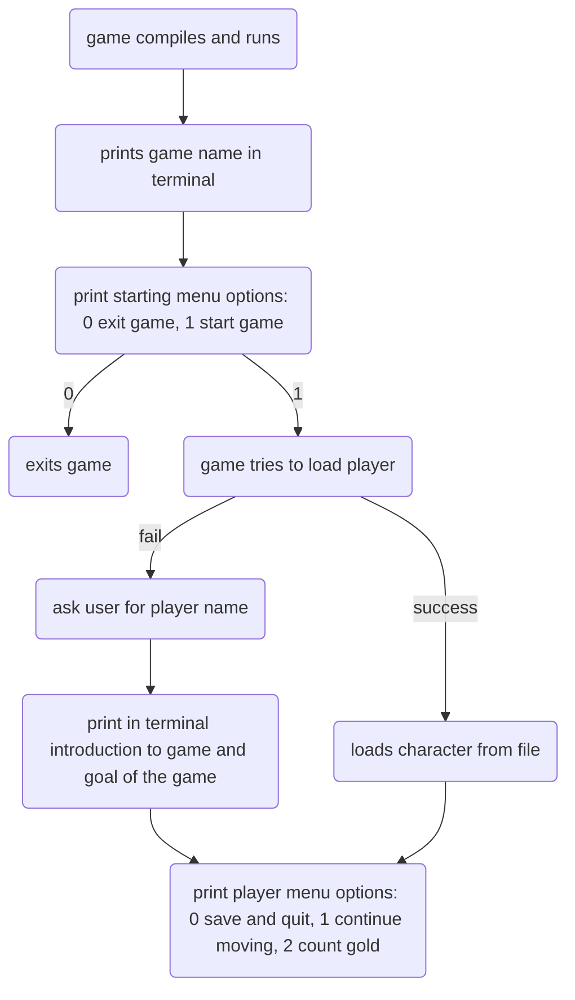
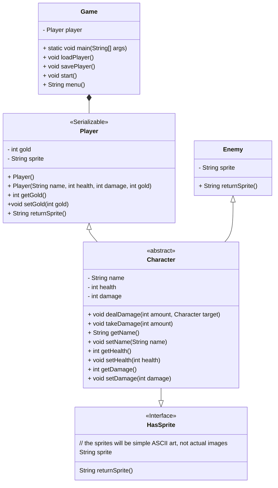

# CS121-Final

# Game Flow


# Class Diagram


# Sprites (subject to change)
### Player:
```
"    :)\n/ | \\\n/ \\"
```

### Prints:
```
    :)
  / | \
   / \
```

### Enemy:
```
"   >:(\n/ | \\\n/ \\\n"
```

### Prints:
```
   >:(
  / | \
   / \
```