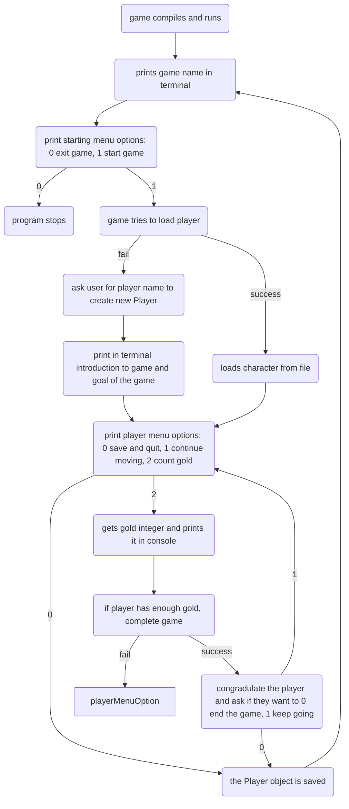
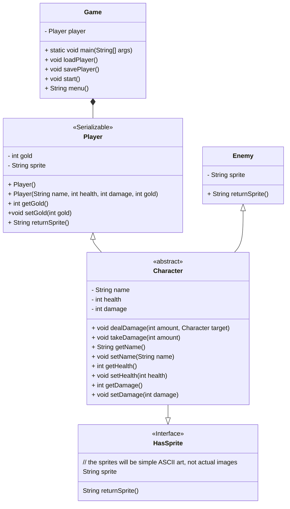

# CS121-Final
This will be a simple text-based game ran in the terminal. It will be similar to the banking app we made, where a serialized class is saved for user data and everything will be done through a menu in the terminal. You will play as an adventurer who needs to get a certain amount of gold. You get this gold by fighting monsters.

# Game Flow


# Class Diagram


# Sprites (subject to change)
## Player
### String:
```
"    :)\n/ | \\\n/ \\"
```

### Prints:
```
    :)
  / | \
   / \
```

## Enemy
### String:
```
"   >:(\n/ | \\\n/ \\\n"
```

### Prints:
```
   >:(
  / | \
   / \
```