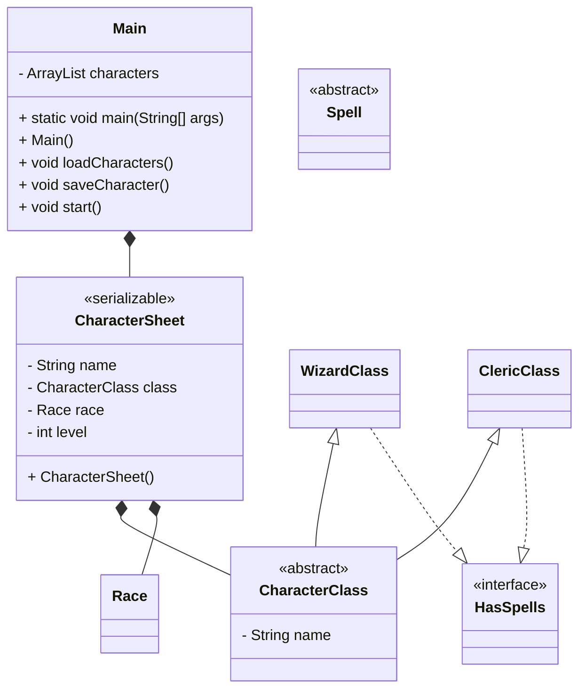

# CS121-Final
For our final project, we need to make an app from scratch. I had 2 ideas, I decided to go with my second one. You can see everything for the first idea in the idea1.md file.

# Dungeons and Dragons Character Sheet Creator
This app will let the user create and store character sheets for DnD.<br>
Intended users: Anyone who plays Dungeons and Dragons<br>
Purpose: This program is supposed to make it easy for players to create, store, and edit character sheets.<br>
Technologies/structures needed:
- Ability to save data
- Ability to load data
- Take data from user to create character sheets
- Dynamic list

# Use-case Analysis
Using the app will look something like this. The final product will be more detailed, this is just to get an idea of what to make.
```
DnD Character Sheet Creator
0) quit
1) create character
2) view stored characters

1)
editing character sheet
0) save and quit
1) name
2) race
3) class

1)
current name: blank
enter name:
jeremy

1)
editing character sheet
0) save and quit
1) name
2) race
3) class

2)
current race: blank
select race:
0) dragonborn
1) dwarf
2) elf
3) gnome
4) human
5) tiefling

4)
editing character sheet
0) save and quit
1) name
2) race
3) class

3)
current class: blank
select class:
0) cleric
1) fighter
2) paladin
3) ranger
4) wizard

1)
editing character sheet
0) save and quit
1) name
2) race
3) class

0)
DnD Character Sheet Creator
0) quit
1) create character
2) view stored characters

2)
stored characters:
0) back
1) jeremy

1)
options:
0) back
1) view
2) edit
3) delete

1)
name: jeremy
race: human
class: wizard

options:
0) back
1) view
2) edit
3) delete

0)
stored characters:
0) back
1) jeremy

0)
DnD Character Sheet Creator
0) quit
1) create character
2) view stored characters

0)
goodbye!
```

# Data Design
The way this app will manage data will be with serializable classes. Data received from the user will be stored in a serializable class called CharacterSheet. Each character sheet the user creates will store it's data in a CharacterSheet object. All of these objects will be stored in a list (like and ArrayList or maybe a LinkedList). Because CharacterSheet will be serializable, it will allow this list of objects to be saved in a .dat file. This will allow the created character sheets to be loaded later on even if the program has been stopped before.

# Algorithm


# Character Sheet Requirements
List of things a character sheet needs:
- Name
- Race
- Class
- Level