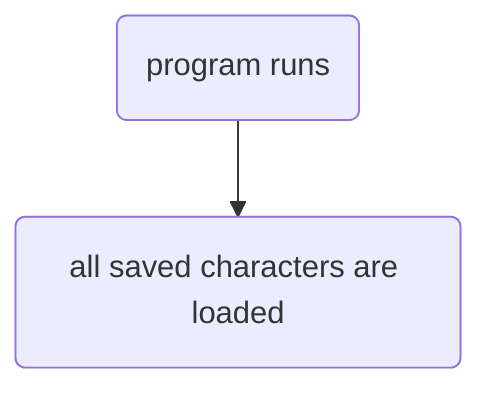

# Dungeons and Dragons Character and Monster Sheets
This app will let the user create and store character sheets for DnD. It will use an API (https://www.dnd5eapi.co/api) to get stats, classes, spells, etc.

# Use-case Analysis
```
DnD Character Sheet Creator
0) quit
1) create character
2) view stored characters

1)
editing character sheet
0) save and quit
1) name
2) race
3) class

1)
current name: blank
enter name:
jeremy


```

# Flowchart
