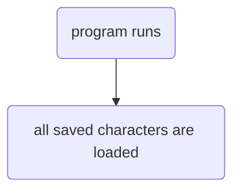

# Dungeons and Dragons Character and Monster Sheets
This app will let the user create and store character sheets for DnD. It will use an API (https://www.dnd5eapi.co/api) to get stats, classes, spells, etc.

# Use-case Analysis Prototype
Using the app will look something like this. The final product will be more detailed, this is just to get an idea of what to make.
```
DnD Character Sheet Creator
0) quit
1) create character
2) view stored characters

1)
editing character sheet
0) save and quit
1) name
2) race
3) class

1)
current name: blank
enter name:
jeremy

1)
editing character sheet
0) save and quit
1) name
2) race
3) class

2)
current race: blank
select race:
0) dragonborn
1) dwarf
2) elf
3) gnome
4) human
5) tiefling

4)
editing character sheet
0) save and quit
1) name
2) race
3) class

3)
current class: blank
select class:
0) cleric
1) fighter
2) paladin
3) ranger
4) wizard

1)
editing character sheet
0) save and quit
1) name
2) race
3) class

0)
DnD Character Sheet Creator
0) quit
1) create character
2) view stored characters

2)
stored characters:
0) back
1) jeremy

1)
options:
0) back
1) view
2) edit
3) delete

1)
name: jeremy
race: human
class: wizard

options:
0) back
1) view
2) edit
3) delete

0)
stored characters:
0) back
1) jeremy

0)
DnD Character Sheet Creator
0) quit
1) create character
2) view stored characters

0)
goodbye!
```

# Flowchart
